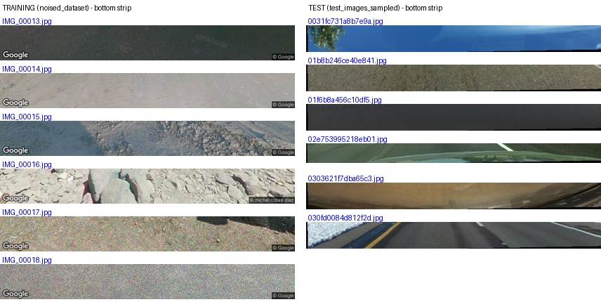

# image geolocation

give it a street photo and it guesses where in the world it was taken. it outputs a lat, lon and a radius in km for how confident it is.

made this for the AI Club IIT Madras geolocation competition on kaggle. we came 1st within IITM. the final model is in `notebook/nn-ensemble-model.ipynb`.

## how it works

we didn't train any big model. we took 3 pretrained image models (CLIP, SigLIP 2 and DINOv2), ran every photo through them once and saved the embeddings. the three get stuck together into one vector per image.

then we split the world into ~1700 regions (geocells), smaller where there are more photos, and trained a small neural net to predict which region a photo is from. we trained 5 of these with different seeds and averaged them, and that was our biggest jump in score.

the final guess is the best spot inside the most likely regions, with a flat 500 km radius for every image.

## the scoring

the formula wasn't given, so we worked it out by submitting probe files. roughly:

```
score = 100*exp(-distance/1493) + 15*(±1)*exp(-radius/500) + small country bonus
```

it's +1 if the real location is inside your radius and -1 if not, and the leaderboard takes the median across all images.

since it's the median, only the middle image really matters. so one flat radius just above our typical error beat a fancy per-image radius every time.

## other stuff

- 19k training images wasn't enough, so we added 60k street photos from OSV-5M. we checked them against the test set so no test images leaked in. scripts to rebuild them are in `data/`
- training images had a google watermark at the bottom and test images didn't. cropping it out helped a lot

  

- we tried denoising the training images and it made everything worse
- StreetCLIP got banned midway, which dropped us from ~50 to ~35. plain CLIP got us back to 43, and the ensemble + extra data took us to 91.4

## running it

made for kaggle with a T4 GPU. upload the notebook, attach the competition data, fill in the paths in cell 1 and run all. the first run takes a while because it extracts embeddings, after that it's quick. it writes out `submission.csv`.

the competition data isn't included here.

## credits

CLIP (OpenAI), SigLIP 2 (Google), DINOv2 (Meta), soft label formula from the [PIGEON paper](https://arxiv.org/abs/2307.05845), extra data from [OSV-5M](https://huggingface.co/datasets/osv5m/osv5m) (CC-BY-SA 4.0).
